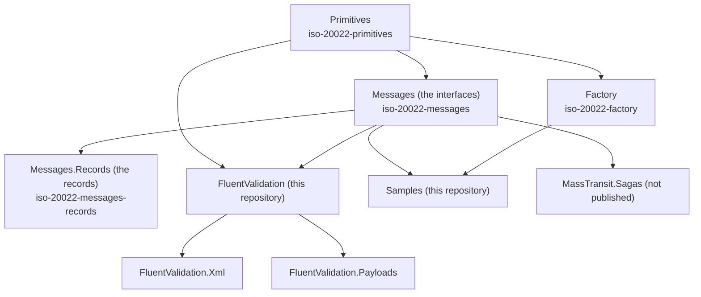

# Package dependencies

Each package that left this repository is published from its own repository (see `CLAUDE.md`); a package depends on the packages below it as a **range**, from the lowest version it works with up to just below the next breaking change (the second part of the version), for example `[1.0.0-alpha, 1.1.0)`.

| You want | Install |
|---|---|
| the primitive types and code sets, and the XML and JSON serializers | `BeneficialStrategies.Iso20022.Primitives` |
| the shape of every message, component and choice | `BeneficialStrategies.Iso20022.Messages` |
| the ready-made records | `BeneficialStrategies.Iso20022.Messages.Records` (brings the interfaces and the primitives) |
| to read a message without the records | `BeneficialStrategies.Iso20022.Factory` and `Messages` |
| the rules the types cannot express | `BeneficialStrategies.Iso20022.FluentValidation` |
| valid objects for tests | `BeneficialStrategies.Iso20022.Samples` |

Rules that held in the monorepo and hold between the repositories: Primitives references nothing of ours; the records are the only package that implements the interfaces; the Factory knows nothing of the Samples, and the Samples use the Factory.
