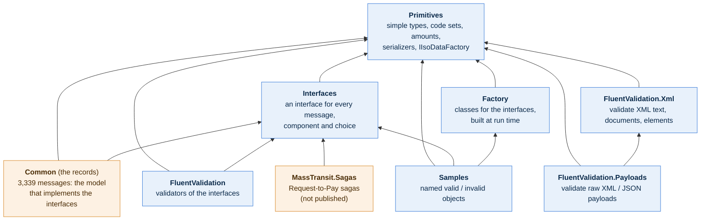
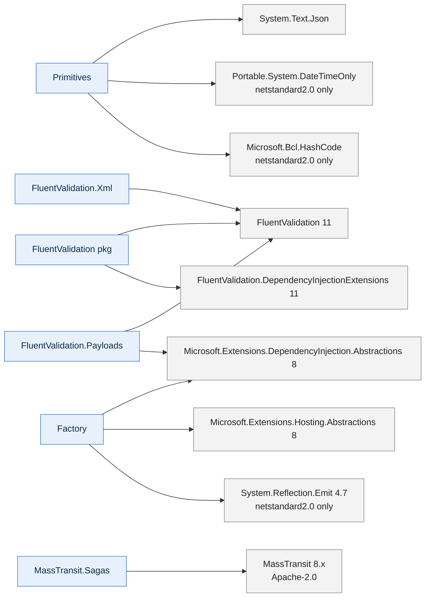
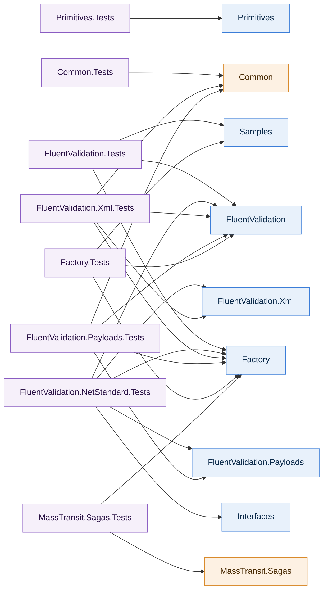

# Package dependencies

> Draft, read from the project files of this repository (`src/*/*.csproj`) as of `main` after #89. An arrow means "references".

The packages form a small tree with one root (`Primitives`) and one deliberate split: the **interfaces** of the model (`Interfaces`) are separate from the **records** that implement them (`Common`). Everything that works on messages (validators, payload validation, the factory, the samples, the sagas) is written against the interfaces, so none of it references `Common`.

## The packages

| Colour | Targets |
|---|---|
| blue | `netstandard2.0`, `net8.0`, `net10.0` (usable from .NET Framework 4.6.1+, Mono and Unity) |
| orange | `net8.0`, `net10.0` only |

## What each one brings in besides the packages above

(`Polyfill` is a build-time-only dependency of the `netstandard2.0` builds and is not listed. Every package listed is MIT, Apache-2.0, BSD or ISC; `tools/licenses/check.sh` enforces it for the published projects.)

## Choosing what to install

| I want to... | Install | Not needed |
|---|---|---|
| Use the primitive types and code sets, or read/write the serializer formats | `Primitives` | everything else |
| Program against message shapes with a class of my own | `Interfaces` | `Common` |
| Work with the ready-made message records (and their XML / JSON) | `Common` (brings `Interfaces`, `Primitives`) | |
| Validate messages | `FluentValidation` | `Common` |
| Validate XML or JSON text without writing a class for it | `FluentValidation.Payloads` (brings `.Xml`) | `Common`, `Interfaces` |
| Read a message without the records | `Factory` (+ `Interfaces` for the shapes) | `Common` |
| Write tests that need valid objects | `Samples` (brings `Factory`, `Interfaces`) | `Common` |
| Run the Request-to-Pay sagas on MassTransit | `MassTransit.Sagas` (not published) + `Factory` in your app | `Common` |

## The same, for the tests of this repository

Not part of the packages; shows which test projects still need `Common`: only `Common.Tests` should, and `Xml.Tests` and `Payloads.Tests` until their tests move onto the samples (#88).

`Xml.Tests` and `Payloads.Tests` still build the same pacs.029 message with the records; the samples for it exist now, so the next change moves them over. `Factory.Tests` no longer references `Common`: what the records write (XML and JSON) is kept in it as fixed text.

## Rules the diagram encodes

1. **`Primitives` references nothing of ours.** Everything else reaches it.
2. **Only `Common` references the records' side of the model;** nothing else may. `Payloads`, `Factory` and the sagas each have a test that their assembly does not reference `Common`.
3. **`Interfaces` and `Common` share their namespaces** (`Components`, `Choices`, one per message area); a caller sees one model.
4. **`FluentValidation.Xml` does not reference `Interfaces`:** it is generic over the type it is given. `Payloads` builds on `Xml`.
5. **`Samples` references `Factory`** (it builds objects with it); `Factory` knows nothing of `Samples`.

## Open points

* **Published or not:** the root README lists `Common`, `Primitives` and `FluentValidation` as published; `Interfaces`, `.Xml`, `.Payloads`, `Factory` and `Samples` are packable and wired into `publish.yml` and the license check, but I have not checked which are on NuGet today; the sagas are not published. The diagram does not show this; say if it should (a fourth colour).
* **Namespaces:** the CLR namespaces cross these package boundaries (`Validation.*` spans three packages); the proposed standard is #83.
